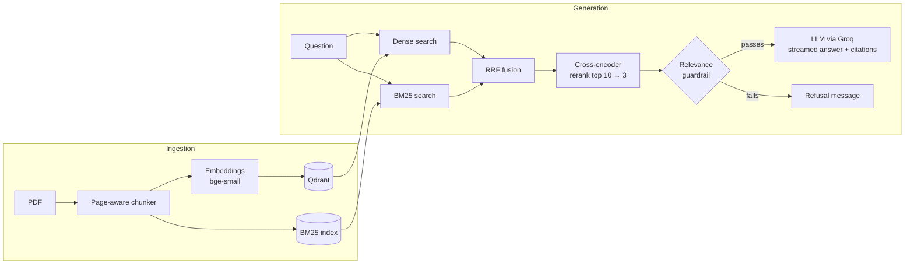

<p align="center">
  
</p>

<h1 align="center">Page Wise</h1>

<p align="center">
  A production-ready RAG assistant featuring hybrid search, cross-encoder reranking, and hallucination guardrails.
</p>

<!-- Replace with your own 10-second GIF: upload a PDF, ask a question, open "View Sources" -->
<p align="center">
  
</p>

Upload a PDF, ask questions in plain language, and get streamed answers written only from the document's own text. Every answer cites the pages it came from, and if the document doesn't contain the answer, the app says so instead of guessing.

## Features

- **Hybrid retrieval.** Dense vector search (Qdrant) and keyword search (BM25) run in parallel and are merged with Reciprocal Rank Fusion, so both meaning and exact terms such as clause numbers are matched.
- **Cross-encoder reranking.** The top 10 fused candidates are rescored by a cross-encoder, and only the best 3 reach the LLM.
- **Strict source attribution.** Every chunk keeps its filename and page number. Answers cite them inline, and a **View Sources** panel shows the exact passages used.
- **Anti-hallucination guardrails.** A relevance floor on the reranker score blocks weak retrievals before the LLM is called, and the prompt forces a fixed refusal when the passages don't answer the question.
- **Streaming UI.** A Streamlit interface with live token streaming, light and dark themes, and an empty-state walkthrough.
- **Observability.** Optional Langfuse tracing records latency, token usage and retrieved chunks for every query.
- **Retrieval evaluation.** A small script measures hit-rate@3 on a hand-labelled question set.

## Architecture



## Quickstart

Requires Python 3.10+ and a free [Groq API key](https://console.groq.com).

```bash
git clone https://github.com/YOUR-USERNAME/page-wise-rag.git
cd page-wise-rag

python3 -m venv venv
source venv/bin/activate          # Windows: venv\Scripts\activate
pip install -r requirements.txt

export GROQ_API_KEY="your_key_here"
streamlit run app.py
```

Open http://localhost:8501, upload a text-based PDF, and start asking questions. The first upload downloads two small models (about 220 MB) from Hugging Face; after that they are cached.

**Try the UI without any models or API key:** set `USE_MOCK = True` at the top of `app.py`.

**Optional tracing:** set `LANGFUSE_PUBLIC_KEY`, `LANGFUSE_SECRET_KEY` and `LANGFUSE_HOST` (see [Langfuse](https://langfuse.com)) before launching. Tracing switches on only when the keys are present.

## Configuration

All tunables live in `config.py`.

| Setting | Default | Purpose |
|---|---|---|
| `LLM_MODEL` | `openai/gpt-oss-120b` | Model served by Groq. Check Groq's current model list if you get a 404. |
| `CHUNK_WORDS` / `CHUNK_OVERLAP` | 200 / 40 | Chunk size and overlap, in words. |
| `CANDIDATES` | 20 | Results fetched from each of dense and BM25 search. |
| `RERANK_POOL` / `FINAL_K` | 10 / 3 | Candidates reranked, and chunks sent to the LLM. |
| `MIN_RERANK_SCORE` | `-9.0` | Relevance floor for the guardrail. |

## Engineering trade-offs

**Hybrid search over dense-only.** Embeddings capture meaning but handle exact tokens poorly. In testing, a question like "question 1" failed against a document that says "Question # 01" until I normalized numbers in the BM25 tokenizer and in the query. Combining both retrievers covers each other's blind spots, and RRF merges them without needing comparable scores.

**Chunk size of 200 words with 40 overlap.** Chunks are built per page so every citation maps to exactly one page. 200 words is large enough to hold a full paragraph or a numbered question, and small enough that the reranker can judge relevance sharply. The overlap keeps sentences that straddle a boundary intact.

**Reranking the top 10 down to 3.** Bi-encoder similarity is fast but coarse, while a cross-encoder reads the question and passage together and typically orders results more accurately. Sending only 3 chunks to the LLM also cuts cost and the chance of distraction.

**A loose relevance floor plus an LLM judge, not a hard cutoff.** The cross-encoder's raw scores drop sharply for short or vague queries even when the right chunk is ranked first (for example, the correct chunk scored −6.6 for "explain question 01" but +0.6 for "question 1"). A strict threshold therefore refused answerable questions. The floor now only rejects clearly unrelated queries, and the prompt tells the LLM to refuse when the passages don't contain the answer.

**Plain libraries instead of a framework.** Retrieval, fusion and the guardrail are written directly with `sentence-transformers`, `qdrant-client` and `rank_bm25`, which keeps each step visible, testable and easy to swap.

## Evaluation

```bash
python eval/run_eval.py path/to/document.pdf
```

Add questions and the page that answers each one to `eval/golden.json`. The script compares dense-only, BM25-only, hybrid and reranked retrieval (hit-rate@3), and reports how often the guardrail blocks unanswerable questions and wrongly blocks answerable ones.

**Result.** On an 11-question test set built from one short PDF (9 chunks), the correct page appeared in the top 3 results for 8 of 8 answerable questions. The guardrail blocked 3 of 3 unanswerable questions and wrongly blocked 0 of 8 answerable ones. The set is small, so treat this as a sanity check rather than a benchmark.

## Project structure

```
app.py          Streamlit interface (upload, chat, sources)
ingest.py       PDF text extraction and page-aware chunking
retriever.py    Hybrid index: Qdrant + BM25, RRF fusion, reranking
rag.py          Retrieval guardrail, prompt, streaming LLM call, tracing
config.py       Models and tuning constants
eval/           Retrieval hit-rate evaluation
```

## Limitations

- One PDF at a time, and text-based PDFs only. Scanned documents need an OCR step first.
- Retrieval sends only 3 chunks, so questions that need the whole document (summaries, "how many sections are there?") are answered poorly.
- Index and chat history live in memory and are lost when the session ends.

## Roadmap

- Multi-document search with per-file citations
- Query rewriting to handle terse questions
- Summarization mode for whole-document questions
- Faithfulness scoring with Ragas or DeepEval
- Docker image for one-command setup

## Tech stack

Python · Streamlit · sentence-transformers (BAAI/bge-small-en-v1.5, ms-marco MiniLM cross-encoder) · Qdrant · rank_bm25 · PyMuPDF · Groq · Langfuse